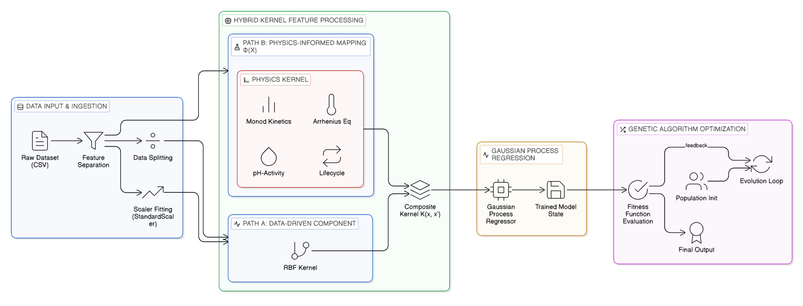
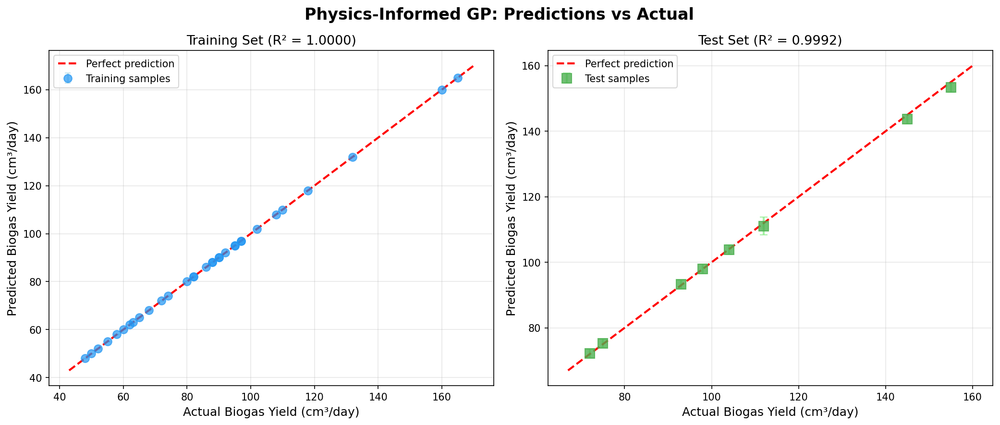
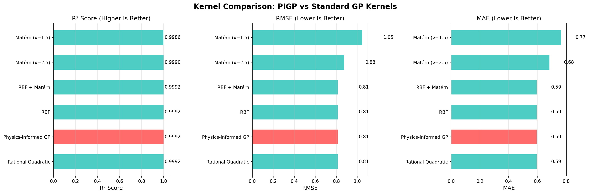
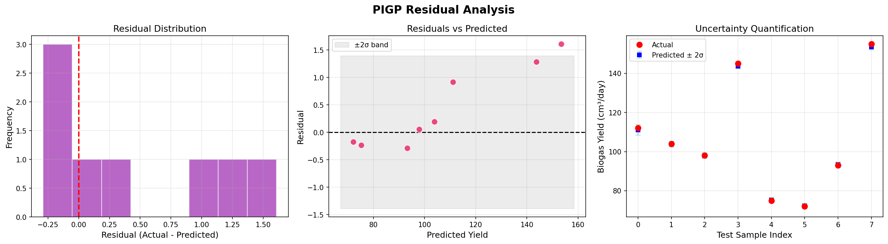
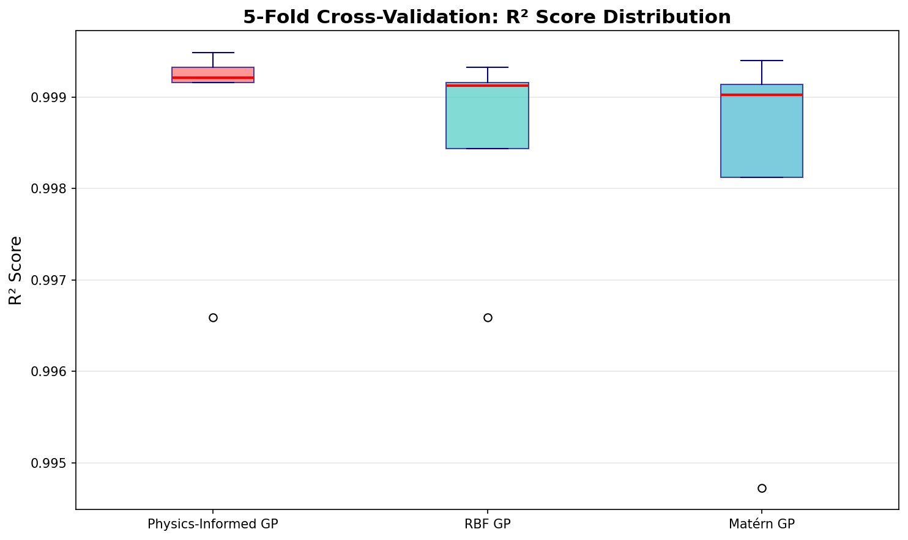
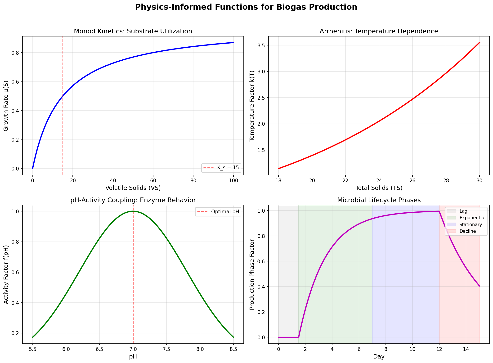
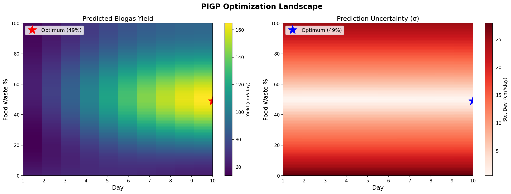
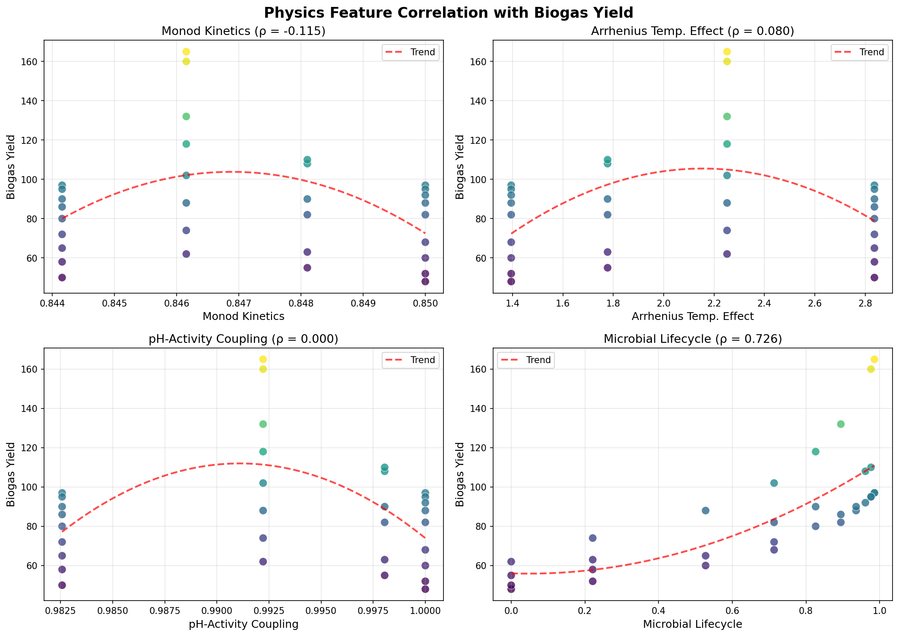

<div align="center">

# 🔬 Physics-Informed Gaussian Process Regression<br/>for Biogas Yield Prediction

### *Teaching a Gaussian Process the laws of anaerobic digestion — then letting a genetic algorithm search the landscape it learns.*

[](https://www.python.org/)
[](https://scikit-learn.org/)
[](https://pygad.readthedocs.io/)
[](https://jupyter.org/)
[](LICENSE)

<br/>

**`Scientific ML`** · **`Gaussian Processes`** · **`Custom Kernel Design`** · **`Uncertainty Quantification`** · **`Evolutionary Optimization`** · **`Renewable Energy`**

</div>

---

## 📖 About

Most machine-learning models for bioprocesses are black boxes: they interpolate well inside the data they were shown and go quietly wrong outside it. **This project takes the opposite approach — it writes four decades of anaerobic-digestion biochemistry directly into the model's covariance function.**

Concretely, it implements `PhysicsInformedBioEnergyKernel`, a **custom scikit-learn kernel written from scratch** (subclassing `sklearn.gaussian_process.kernels.Kernel`, with its own hyperparameter declarations and a finite-difference gradient for marginal-likelihood optimisation). The kernel measures similarity between two digester states along **two parallel paths**:

- **Path A — data-driven:** a standard RBF kernel over the seven standardised physicochemical inputs.
- **Path B — physics-informed:** an RBF kernel over a four-dimensional *physics embedding* `φ(x)` built from **Monod substrate kinetics, an Arrhenius temperature factor, a Gaussian pH-activity window, and a modified-Gompertz microbial lifecycle curve**.

Two digester states are therefore "close" not only when their raw measurements look alike, but when the **underlying biology is doing the same thing**. A Gaussian Process over that kernel returns a yield prediction *and* a calibrated confidence interval — and a **PyGAD genetic algorithm** then searches the learned surface using a **lower-confidence-bound** fitness, so the recommended feedstock blend is one the model is both optimistic *and* certain about.

> **Why it matters:** anaerobic digesters are slow, expensive experiments — a single feedstock trial runs for weeks. A model that is honest about its own uncertainty tells an operator *where it is worth spending the next experiment*, which is a far more useful object than a point estimate.

---

## ⚡ Highlights

<table>
<tr>
<td width="50%" valign="top">

### 🧪 Physics in the kernel, not the loss
Most "physics-informed" ML bolts a penalty onto the loss function. This encodes domain knowledge in the **prior** — the GP cannot express a covariance structure that contradicts the biology it was given.

</td>
<td width="50%" valign="top">

### 📐 Uncertainty as a first-class output
Every prediction ships with ±2σ bounds. The optimiser consumes them directly via a **Lower Confidence Bound** fitness, trading raw yield against predictive confidence.

</td>
</tr>
<tr>
<td width="50%" valign="top">

### 🧬 Closed loop: model → search → recommendation
A 100-generation genetic algorithm over the GP surface converts a regressor into an actual **engineering decision**: the feedstock ratio to load into the digester.

</td>
<td width="50%" valign="top">

### 🔍 Honest diagnostics
Six kernels benchmarked head-to-head, 5-fold CV, residual analysis, and a documented, **non-flattering** finding about what the physics branch actually contributed. See [Limitations](#-limitations--what-the-numbers-really-say).

</td>
</tr>
</table>

---

## 🏗️ Architecture

<div align="center">

</div>

```
                             ┌──────────────────────────┐
  biogas_ml_dataset.csv ───▶ │   StandardScaler fit      │
    (40 × 7 features)        └────────────┬─────────────┘
                                          │
                   ┌──────────────────────┴──────────────────────┐
                   ▼                                             ▼
        PATH B · PHYSICS EMBEDDING                   PATH A · DATA-DRIVEN
        φ(x) ∈ ℝ⁴                                    x ∈ ℝ⁷ (standardised)
        ├── Monod      μ(VS)                                   │
        ├── Arrhenius  k(TS)                                   │
        ├── pH window  f(pH)                                   │
        └── Lifecycle  g(Day)                                  │
                   │                                           │
          K_physics = σ²_phy · RBF(φ)                K_data = σ²_dat · RBF(x)
                   └──────────────────┬────────────────────────┘
                                      ▼
                    K = (1−w)·K_data + w·K_physics + σ²_noise·I
                                      │
                         GaussianProcessRegressor
                                      │
                      ┌───────────────┴───────────────┐
                      ▼                               ▼
                 ŷ  (cm³/day)                    σ  (uncertainty)
                      └───────────────┬───────────────┘
                                      ▼
                    PyGAD · fitness = ŷ − 0.5σ  (LCB)
                                      ▼
                        Optimal feedstock composition
```

---

## 📊 Results

> All figures below are reproduced verbatim from the committed notebook run — `pi_gpr_biogas_optimization.ipynb`, 32 train / 8 test split, `random_state=42`.

### Kernel benchmark — test set

| Rank | Kernel | R² ↑ | RMSE ↓ | MAE ↓ | Log-Marginal-Likelihood ↑ |
|:---:|:---|:---:|:---:|:---:|:---:|
| 🥇 | Rational Quadratic | **0.99916** | **0.8130** | **0.5947** | 27.5638 |
| 🥈 | **Physics-Informed GP** | **0.99916** | 0.8130 | 0.5947 | **27.5638** |
| 🥉 | RBF | 0.99916 | 0.8131 | 0.5947 | 27.5638 |
| 4 | RBF + Matérn | 0.99916 | 0.8131 | 0.5947 | 27.5638 |
| 5 | Matérn (ν = 2.5) | 0.99903 | 0.8760 | 0.6842 | 24.3556 |
| 6 | Matérn (ν = 1.5) | 0.99861 | 1.0478 | 0.7653 | 18.4066 |

### 5-fold cross-validation

| Model | Mean R² | Std |
|:---|:---:|:---:|
| **Physics-Informed GP** | **0.9988** | ± 0.0011 |
| RBF GP | 0.9985 | ± 0.0010 |
| Matérn GP | 0.9981 | ± 0.0017 |

Per-fold PI-GPR R²: `0.9992` · `0.9992` · `0.9995` · `0.9966` · `0.9993`

### Optimised feedstock

<div align="center">

| | |
|---:|:---|
| **Food waste** | **49 %** |
| **Weed biomass** | **51 %** |
| **Predicted yield** | **164.57 cm³/day** |
| **95 % CI** | `[162.58, 166.55]` cm³/day |
| **Uncertainty (±2σ)** | ± 1.98 cm³/day |

</div>

Physics state at the recommended optimum — Monod `0.8461` · Arrhenius `2.2727` · pH activity `0.9922` · Lifecycle `0.9857`.

📄 **Full tables, fitted hyperparameters and figure-by-figure interpretation → [`docs/RESULTS.md`](docs/RESULTS.md)**

---

## 🖼️ Figure Gallery

<div align="center">

| Predictions vs Actual | Kernel Comparison |
|:---:|:---:|
|  |  |
| Train & test parity plots with ±2σ error bars | R², RMSE and MAE across all six kernels |

| Residual Analysis | Cross-Validation |
|:---:|:---:|
|  |  |
| Residual distribution, heteroscedasticity check, uncertainty calibration | Per-fold R² for PI-GPR, RBF and Matérn |

| Physics Functions | Optimisation Landscape |
|:---:|:---:|
|  |  |
| The four domain equations encoded into φ(x) | Yield surface and uncertainty surface over (Food %, Day) |

</div>

<div align="center">

<br/><em>Spearman correlation of each physics-derived feature against observed yield.</em>
</div>

---

## 🧬 The Physics

Four equations convert raw measurements into the embedding `φ(x)`. Each is a textbook relation from anaerobic-digestion literature, with parameters fixed to literature-plausible values (see [`docs/METHODOLOGY.md`](docs/METHODOLOGY.md) for the full parameter table).

<table>
<tr><th width="22%">Mechanism</th><th width="44%">Equation</th><th width="34%">What it captures</th></tr>
<tr>
<td><b>Monod kinetics</b><br/><code>μ(VS)</code></td>
<td></td>
<td>Microbial growth saturates as substrate (volatile solids) becomes abundant. <code>K_s = 15</code>.</td>
</tr>
<tr>
<td><b>Arrhenius factor</b><br/><code>k(TS)</code></td>
<td></td>
<td>Reaction rate rises with digester temperature. TS is used as a proxy, linearly mapped to 30–45 °C.</td>
</tr>
<tr>
<td><b>pH-activity window</b><br/><code>f(pH)</code></td>
<td></td>
<td>Methanogens peak near pH 7.0 and fall off sharply either side. <code>σ_pH = 0.8</code>.</td>
</tr>
<tr>
<td><b>Microbial lifecycle</b><br/><code>g(Day)</code></td>
<td></td>
<td>Modified Gompertz curve: lag → exponential → stationary → decline.</td>
</tr>
</table>

The composite kernel is then

<div align="center">

</div>

with `w = 0.4` fixed and `ℓ, ℓ_phy, σ_data, σ_phy, σ_noise` learned by maximising the log marginal likelihood (5 restarts).

---

## 🚀 Quickstart

```bash
git clone https://github.com/aparijit05072004/Physics-Informed-GPR-for-Biogas-Yield-Prediction.git
cd Physics-Informed-GPR-for-Biogas-Yield-Prediction
```

```bash
python -m venv .venv && source .venv/bin/activate   # Windows: .venv\Scripts\activate
pip install -r requirements.txt
```

```bash
jupyter notebook pi_gpr_biogas_optimization.ipynb
```

> **Running locally?** The notebook was authored on Google Colab. Delete the `drive.mount(...)` cell and change the CSV path in the data-loading cell to `biogas_ml_dataset.csv` — everything else runs unchanged. Expect ~1–2 minutes end to end; the custom kernel's finite-difference gradient is the slow step.

**Open directly in Colab:** [](https://colab.research.google.com/github/aparijit05072004/Physics-Informed-GPR-for-Biogas-Yield-Prediction/blob/main/pi_gpr_biogas_optimization.ipynb)

---

## 📂 Repository Structure

```
Physics-Informed-GPR-for-Biogas-Yield-Prediction/
│
├── pi_gpr_biogas_optimization.ipynb   # ◀ Main notebook — kernel, training, CV, GA
├── biogas_ml_dataset.csv              # 40 observations · 4 blends × 10 days
├── requirements.txt                   # Pinned dependencies
│
├── docs/
│   ├── ABOUT.md                       # Project summary & repo metadata
│   ├── METHODOLOGY.md                 # Kernel derivation, parameters, protocol
│   └── RESULTS.md                     # Complete results & figure interpretation
│
├── assets/                            # All generated figures
│   ├── architecture.png
│   ├── physics-functions.png
│   ├── predictions.png
│   ├── kernel-comparison.png
│   ├── residual-analysis.png
│   ├── physics-feature-analysis.png
│   ├── cross-validation.png
│   └── optimization-landscape.png
│
├── LICENSE                            # MIT
└── README.md
```

### Dataset schema

| Column | Unit | Range | Role |
|:---|:---|:---|:---|
| `TS` | % | 20 – 27.5 | Total solids — also the Arrhenius temperature proxy |
| `VS` | % | 81.25 – 85 | Volatile solids — Monod substrate term |
| `pH` | — | 7.00 – 7.15 | Digester pH |
| `C_N` | ratio | 20 – 31.25 | Carbon-to-nitrogen ratio |
| `Food_pct` | % | 25 – 100 | Food-waste fraction of feedstock |
| `Weed_pct` | % | 0 – 75 | Weed-biomass fraction (constrained: `Food + Weed = 100`) |
| `Day` | day | 1 – 10 | Digestion day |
| `Biogass_Yield` | cm³/day | 48 – 165 | 🎯 **Target** |

The four blends sampled are **100/0, 75/25, 50/50 and 25/75** (food/weed), each tracked over 10 days. `TS`, `VS` and `C_N` are deterministic linear mixtures of the blend ratio.

---

## 🔎 Limitations — what the numbers really say

A results table is easy to write; reading it honestly is the harder part. Three things in this project deserve to be stated plainly rather than buried:

**1. All six kernels are statistically indistinguishable.** PI-GPR, RBF, Rational Quadratic and RBF+Matérn agree to five decimal places (R² = 0.99916). On this dataset the physics-informed kernel is **not measurably better** than a stock RBF. The 40-point dataset is smooth, low-dimensional, and close to noiseless — there is simply no residual structure left for a better prior to exploit.

**2. Marginal-likelihood optimisation switched the physics branch off.** The fitted kernel is

```
length_scale=2.217  physics_length_scale=5.038  σ_data=1.723  σ_physics=0.002  w=0.40
```

With `σ_physics → 0.002`, the physics term contributes `w · σ²_phy ≈ 1.6 × 10⁻⁶` to the covariance — effectively zero. The GP was free to use the physics prior and **chose not to**. That is a real negative result, and the pipeline is built to surface it rather than hide it.

**3. The train/test split is optimistic.** Rows within a blend differ only in `Day`, so a random 80/20 split places near-duplicate neighbours of every test point into the training set. The honest evaluation is **leave-one-blend-out** (train on 3 blends, predict the held-out one) — a genuine extrapolation test, and the setting where a physics prior should finally earn its place. The GA also searches `Food_pct ∈ [0, 100]` while the data only covers `[25, 100]`, so its recommendation extrapolates below 25 %.

**4. The recommended optimum sits on top of an observed point.** 49/51 at day 10 → 164.57 cm³/day is adjacent to the best training observation (50/50, day 10 → 165 cm³/day). The GA is confirming the empirical best, not discovering a new regime.

> **The takeaway:** the engineering — a working custom kernel with analytic hyperparameter plumbing, uncertainty-aware evolutionary search, and a reproducible benchmark harness — is sound and reusable. The dataset is what limits the scientific claim.

---

## 🗺️ Roadmap

- [ ] **Leave-one-blend-out CV** — replace the random split with grouped splits to measure true extrapolation
- [ ] **Ablation on `w`** — sweep the physics weight from 0 → 1 and plot LML against it
- [ ] **Analytic kernel gradients** — replace finite differences for a substantial speed-up
- [ ] **Widen the dataset** — additional blends, pH levels and temperatures to break the current collinearity between `TS`, `VS`, `C_N` and blend ratio
- [ ] **Package as a CLI** — `pigpr fit` / `pigpr optimize` on top of a reusable module
- [ ] **Calibration curves** — verify the ±2σ intervals achieve nominal 95 % coverage

---

## 📚 References

1. Rasmussen, C. E. & Williams, C. K. I. (2006). *Gaussian Processes for Machine Learning*. MIT Press.
2. Raissi, M., Perdikaris, P. & Karniadakis, G. E. (2019). Physics-informed neural networks. *Journal of Computational Physics*, 378, 686–707.
3. Karniadakis, G. E. et al. (2021). Physics-informed machine learning. *Nature Reviews Physics*, 3, 422–440.
4. Batstone, D. J. et al. (2002). *Anaerobic Digestion Model No. 1 (ADM1)*. IWA Publishing.
5. Monod, J. (1949). The growth of bacterial cultures. *Annual Review of Microbiology*, 3, 371–394.
6. Zwietering, M. H. et al. (1990). Modeling of the bacterial growth curve. *Applied and Environmental Microbiology*, 56(6), 1875–1881.

---

## 📝 Citation

```bibtex
@article{roy_pigpr_biogas,
  title       = {A Hybrid Predictive Framework using Machine Learning Models
                 for Optimizing Bio-Energy Generation from Organic Waste},
  author      = {Roy, Aditya and Chakraborty, Aparijit and
                 Bhattacharjee, Tathagata and Hariharan, R. and Rajakani, M.},
  institution = {SRM Institute of Science and Technology, Kattankulathur},
  year        = {2026},
  note        = {Under review}
}
```

---

## 👥 Authors

| Name | Department | Institution |
|:---|:---|:---|
| **Aditya Roy** | Computing Technologies | SRMIST, Chennai |
| **Aparijit Chakraborty** | Computing Technologies | SRMIST, Chennai |
| **Tathagata Bhattacharjee** | Data Science & Business Systems | SRMIST, Chennai |
| **Hariharan R** | Computing Technologies | SRMIST, Chennai |
| **Rajakani M** | Data Science & Business Systems | SRMIST, Chennai |

---

## 📃 License

Released under the [MIT License](LICENSE).

<div align="center">
<br/>

**If this project is useful to you, a ⭐ is appreciated.**

<sub>Built at SRM Institute of Science and Technology · Kattankulathur, Chennai</sub>

</div>
