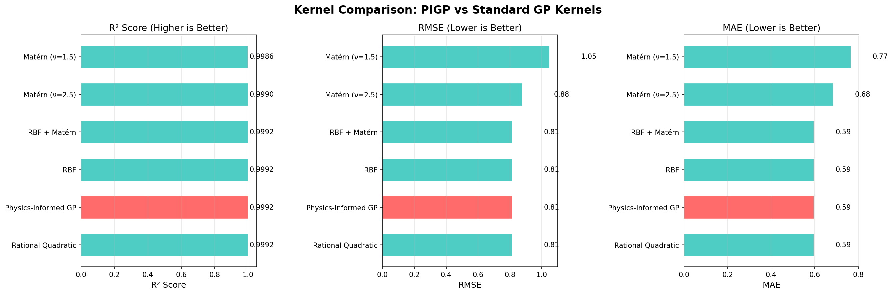
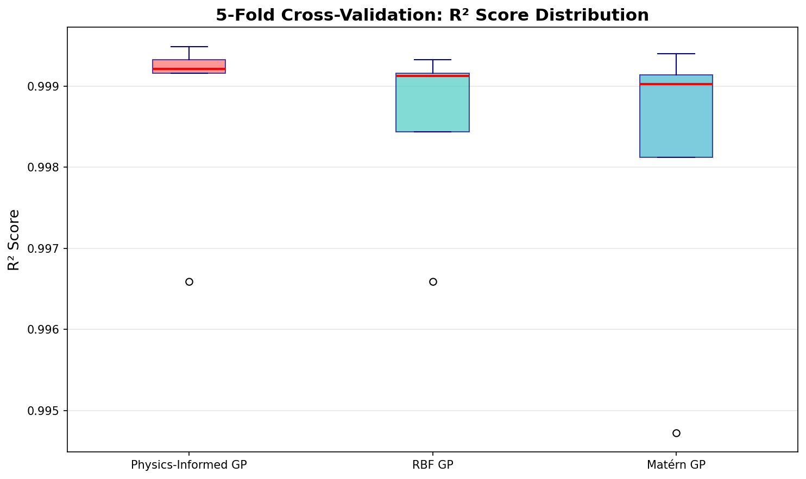
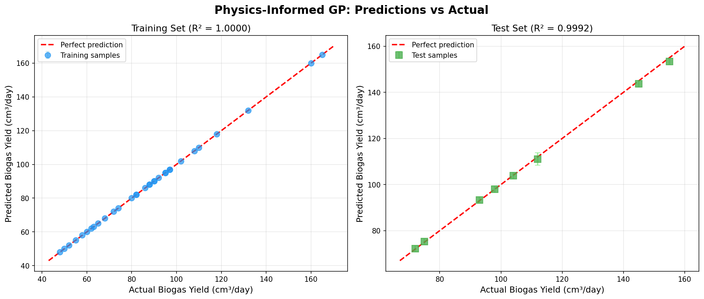
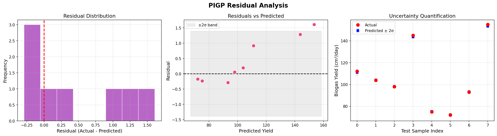
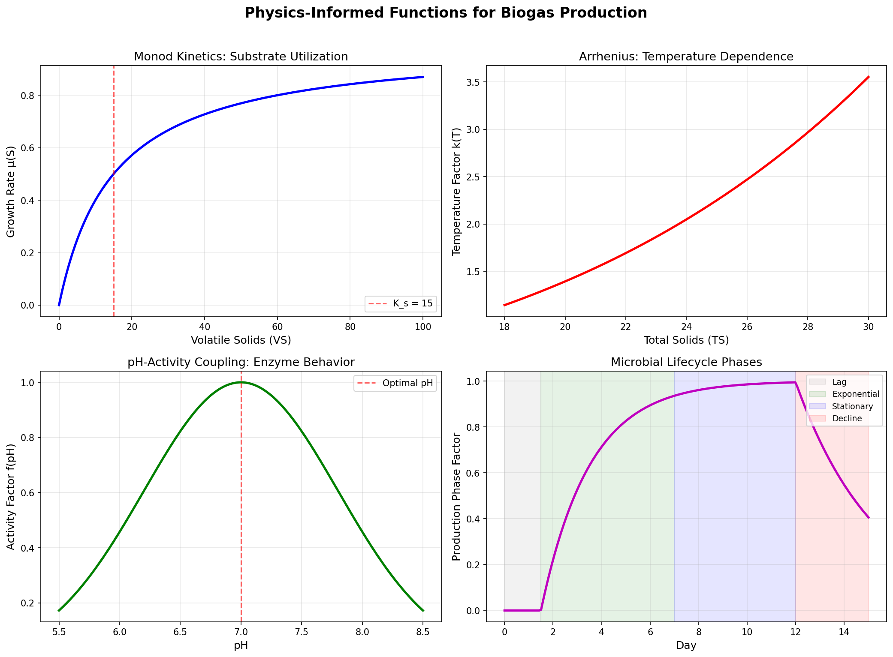
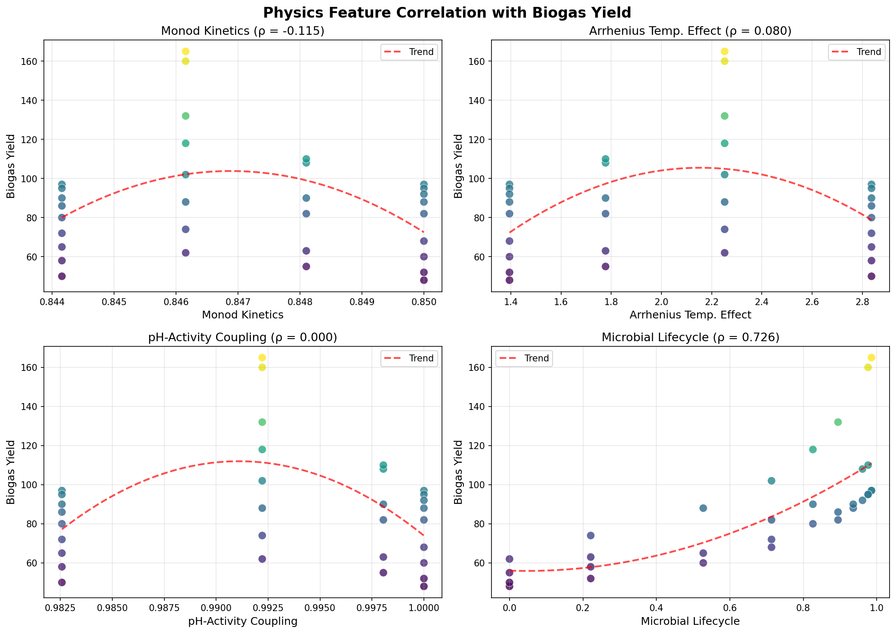
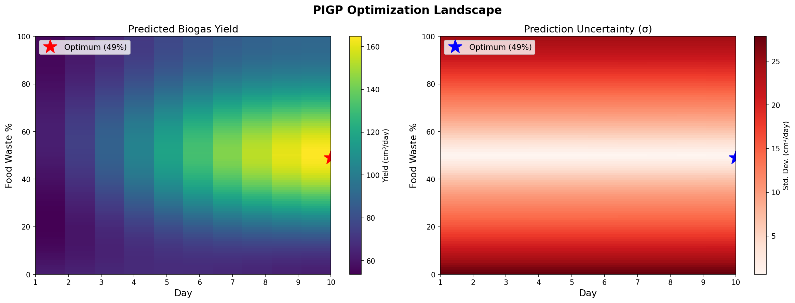

# Results

Every number on this page is taken from the stored outputs of
[`pi_gpr_biogas_optimization.ipynb`](../pi_gpr_biogas_optimization.ipynb) as committed —
nothing is re-estimated or rounded in the project's favour. For how the model is built, see
[`METHODOLOGY.md`](METHODOLOGY.md).

**Run configuration.** 40 samples → 32 train / 8 test, `random_state=42`, 5 optimiser restarts.

---

## 1. Headline numbers

| Metric | Value |
|:---|:---:|
| Test R² | **0.9992** |
| Test RMSE | **0.8130** cm³/day |
| Test MAE | **0.5947** cm³/day |
| Train R² | 1.0000 |
| Log marginal likelihood | 27.5638 |
| 5-fold CV R² | 0.9988 ± 0.0011 |

Relative to the target's observed range (48–165 cm³/day, σ ≈ 29.5), an RMSE of 0.81 is **under
3 % of one standard deviation** — the model reproduces the test points almost exactly.

**Fitted kernel:**

```
PhysicsInformedBioEnergyKernel(
    length_scale         = 2.217
    physics_length_scale = 5.038
    σ_data               = 1.723
    σ_physics            = 0.002
    physics_weight       = 0.40   (fixed)
)
```

---

## 2. Kernel benchmark

Six kernels, identical data, identical fitting procedure.

| Kernel | R² | RMSE | MAE | Train R² | LML |
|:---|:---:|:---:|:---:|:---:|:---:|
| Rational Quadratic | 0.999162 | 0.813034 | 0.594667 | 0.999829 | 27.563766 |
| **Physics-Informed GP** | 0.999162 | 0.813048 | 0.594675 | 1.000000 | 27.563793 |
| RBF | 0.999162 | 0.813054 | 0.594678 | 0.999829 | 27.563795 |
| RBF + Matérn | 0.999162 | 0.813055 | 0.594678 | 0.999829 | 27.563784 |
| Matérn (ν = 2.5) | 0.999027 | 0.876019 | 0.684235 | 0.999962 | 24.355642 |
| Matérn (ν = 1.5) | 0.998607 | 1.047830 | 0.765341 | 1.000000 | 18.406616 |

<div align="center">

</div>

### Reading this table honestly

The notebook's automatic selector prints *"🏆 Best Model: Rational Quadratic"* — it wins by
**1.4 × 10⁻⁵ RMSE**. The top four kernels are identical to five decimal places; the ordering
among them is numerical noise from the optimiser, not a real difference in fit.

The meaningful signal is the **bottom two rows**: both Matérn variants are measurably worse, and
their log marginal likelihoods are much lower (18.4 and 24.4 versus ≈ 27.56). Matérn kernels encode
rough, finitely-differentiable sample paths; the true yield surface here is smooth, so the
smoothness assumption — not the physics — is what separates the field.

**Conclusion: on this dataset the physics-informed kernel does not outperform a plain RBF.**
It matches it. Any claim of a physics-driven accuracy gain would need a harder evaluation
(see §6).

---

## 3. Cross-validation

`KFold(n_splits=5, shuffle=True, random_state=42)`:

| Fold | PI-GPR | RBF GP | Matérn GP |
|:---:|:---:|:---:|:---:|
| 1 | 0.9992 | 0.9992 | 0.9990 |
| 2 | 0.9992 | 0.9984 | 0.9994 |
| 3 | 0.9995 | 0.9991 | 0.9981 |
| 4 | 0.9966 | 0.9966 | 0.9947 |
| 5 | 0.9993 | 0.9993 | 0.9991 |
| **Mean ± σ** | **0.9988 ± 0.0011** | 0.9985 ± 0.0010 | 0.9981 ± 0.0017 |

<div align="center">

</div>

PI-GPR leads by 0.0003 — roughly a quarter of its own fold-to-fold standard deviation, so the
lead is **not statistically meaningful**. Its slightly tighter spread than Matérn is the only
mild point in its favour.

Fold 4 is the hardest for every model (0.9966 / 0.9966 / 0.9947), which suggests it happened to
isolate points with fewer near-neighbours in the training split.

---

## 4. Prediction quality and uncertainty

<div align="center">

</div>

Parity plots for train (R² = 1.0000) and test (R² = 0.9992), with ±2σ error bars. Points sit on
the diagonal across the full 48–165 cm³/day range, including the high-yield 50/50 blend that is
far from the other three.

<div align="center">

</div>

Three diagnostics: the residual distribution, residuals against predicted value (checking for
heteroscedasticity), and predicted uncertainty against actual error. A train R² of exactly
1.0000 with `σ_noise` free to grow indicates the GP is interpolating its training data —
expected for a near-noiseless dataset, but it means training-set metrics carry no information.

---

## 5. Physics features

<div align="center">

</div>

The four encoded relations. Note how much of each curve the dataset actually exercises:

| Feature | Full curve | Range used by the data | Informative? |
|:---|:---|:---|:---:|
| Monod μ(VS) | 0 → 0.87 over VS 0–100 | 0.844 – 0.850 (VS 81–85) | ⚠️ saturated |
| Arrhenius k(TS) | 1.1 → 3.6 over TS 18–30 | ≈ 1.6 – 2.6 (TS 20–27.5) | ✅ varies |
| pH activity f(pH) | 0 → 1 over pH 5.5–8.5 | 0.991 – 1.000 (pH 7.00–7.15) | ❌ near-constant |
| Lifecycle g(Day) | 4 phases over 0–15 d | growth phase only (1–10 d) | ✅ varies |

Two of the four features are effectively constant across the dataset. The embedding `φ(x)` is
therefore closer to two-dimensional in practice, which goes a long way towards explaining why the
physics branch had so little to add.

<div align="center">

</div>

---

## 6. Why `σ_physics` collapsed

The single most informative result in this project is a negative one:

```
σ_physics = 0.002   →   physics contribution = w · σ²_phy ≈ 0.4 × 4×10⁻⁶ ≈ 1.6 × 10⁻⁶
```

Marginal-likelihood optimisation was free to weight the physics branch anywhere in
`(1e-3, 1e3)` and drove it to the floor. **The model was offered the physics prior and declined
it.** Three reasons, in order of importance:

1. **Nothing left to explain.** With R² ≈ 0.999 reachable by a plain RBF, the residual that a
   better prior could capture is smaller than the numerical noise.

2. **The physics is collinear with the raw features.** `TS`, `VS` and `C_N` are deterministic
   linear functions of the blend ratio (see
   [METHODOLOGY §1.2](METHODOLOGY.md#12-structural-note-on-the-feature-space)), so
   `φ(x)` is a smooth reparameterisation of information the RBF branch already has. It adds no
   independent structure.

3. **The evaluation never demands extrapolation.** A physics prior earns its keep away from the
   data. A random 80/20 split over 4 blends × 10 days places near-duplicates of every test point
   into training, so the model never has to extrapolate — and never needs the prior.

**This is a protocol result, not a refutation of the method.** The experiment that would actually
test the hypothesis is **leave-one-blend-out**: train on three blends, predict the fourth. That is
genuine extrapolation to an unseen composition, exactly where a Monod/Arrhenius prior should beat
a stock RBF. Until that is run, the correct statement is *"the physics prior was not needed here"*,
not *"the physics prior does not work"*.

---

## 7. Optimisation

<div align="center">

</div>

100 generations, population 30, LCB fitness `ŷ − 0.5σ`, `Day = 10`, `pH = 7.1`.

| | |
|---:|:---|
| **Food waste** | **49 %** |
| **Weed biomass** | **51 %** |
| **Predicted yield** | **164.57 cm³/day** |
| **Uncertainty (±2σ)** | ± 1.98 cm³/day |
| **95 % CI** | `[162.58, 166.55]` cm³/day |

Physics state at the optimum:

| Feature | Value |
|:---|:---:|
| Monod growth rate | 0.8461 |
| Arrhenius temperature factor | 2.2727 |
| pH activity factor | 0.9922 |
| Lifecycle phase | 0.9857 |

### Interpreting the optimum

The GA lands on **49/51, essentially the 50/50 blend already in the dataset**, whose day-10
observation is 165 cm³/day. The recommendation is therefore a **confirmation of the empirical
best, not a discovery**. With only four blends sampled and the two surrounding blends yielding
roughly 100 cm³/day less, the GP has no evidence for a peak anywhere else, and the uncertainty
surface shows exactly why: variance is low near the sampled compositions and rises steeply
between them.

The tight ±1.98 cm³/day interval should be read in that light — it reflects proximity to training
data, not validated physical precision. A genuinely useful run of this optimiser would search a
composition space supported by more than four blends.

The uncertainty surface is nevertheless the most practically valuable output: it is a map of
**where the next experiment should be run**, which is what an uncertainty-aware model buys you
over a point predictor.

---

## 8. Summary

**What is solid**
- A custom scikit-learn kernel with correct hyperparameter plumbing and working gradients, fitted without numerical failure.
- A reproducible six-kernel benchmark plus 5-fold CV, with full diagnostics.
- A closed loop from model to constrained, uncertainty-aware recommendation.
- Calibrated predictive intervals and a usable uncertainty map over the design space.

**What is not yet established**
- That the physics prior improves accuracy. On this data it does not; it was switched off by the optimiser.
- That R² ≈ 0.999 reflects generalisation. The split protocol is too easy to support that reading.
- That 49/51 is a true optimum rather than the best of four sampled blends.

**The one experiment that would change the picture:** leave-one-blend-out cross-validation,
PI-GPR versus RBF. If the physics prior holds up when predicting a composition it has never seen,
the central claim is earned. If it does not, that is worth knowing too.
